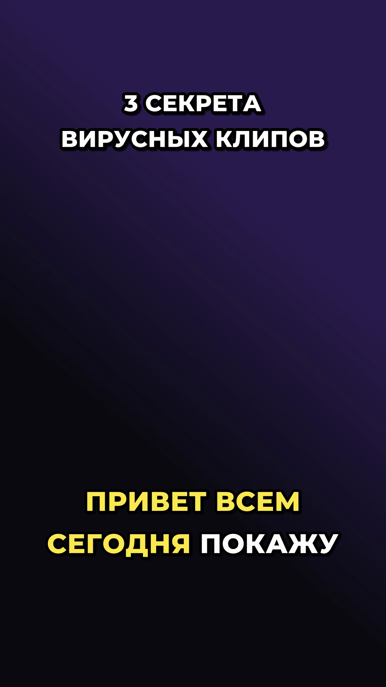

# ViralCut 1.1.3 — iOS-интерфейс, спокойные субтитры и свои шрифты

## Что изменилось

### 1. Интерфейс в стиле iOS (градиент сохранён)

- Системная типографика (SF Pro / `-apple-system`), крупные заголовки, плотный трекинг.
- Стеклянные поверхности с `backdrop-filter`, скругления 22–28 px, тонкие хайрлайны.
- Настройки — сгруппированный список как в iOS Settings: иконка, подпись, контрол справа.
- iOS-переключатели (48×29), сегмент-контролы с «пилюлей», слайдеры с крупным бегунком.
- Модальные окна — листы с «грабером», размытым фоном и плавным появлением.
- Градиент бренда (фиолетовый → розовый) остался на кнопках, логотипе, прогрессе и заголовке.
- Адаптив: боковая панель становится верхней, настройки — в одну колонку, мобильная ширина
  без горизонтальной прокрутки.

Скриншоты: `docs/screenshots/ui-home-ios.png`, `ui-results-ios.png`,
`ui-editor-ios.png`, `ui-template-ios.png`, `ui-live-ios.png`.

### 2. Субтитры: спокойный темп и караоке

Раньше каждое слово было отдельной репликой: текст и подсветка переключались несколько
раз в секунду — зрители жаловались, что «субтитры очень быстрые».

Теперь:

- один блок текста на реплику, слова закрашиваются акцентом по мере речи (караоке);
- настройка темпа **«Спокойно / Обычно / Быстро»** (по умолчанию «Спокойно»):
  - «Спокойно» — длинные реплики (до 8 слов / 2 строки), паузы до 1,1 с остаются внутри
    блока, после речи блок висит ещё ~0,6 с;
  - «Обычно» — короче и быстрее;
  - «Быстро» — короткие блоки для плотной динамичной нарезки.
- настройка доступна на главной, в шаблоне перед нарезкой и в редакторе клипа,
  сохраняется в настройках клипа и применяется при перерендере;
- в шаблоне темп показан анимацией в предпросмотре.

### 3. Свои шрифты в редакторе и шаблоне

Кнопка «＋» рядом с выбором шрифта:

- на главной (было и раньше),
- в настройке шаблона,
- в редакторе готового клипа (перерендер).

Шрифт TTF/OTF загружается, появляется в группе «Мои шрифты», сразу выбирается в текущем
селекте и применяется при перерендере. В редакторе добавлен живой пример начертания.
Уже загруженный шрифт используется libass через `fontsdir` — ничего дополнительно
устанавливать в систему не нужно.

## Проверка

- `node --check web/app.js`, `py_compile` всех модулей — без ошибок.
- Playwright: главная, результаты, редактор, шаблон, эфир, мобильная ширина — без
  горизонтального переполнения и ошибок консоли; размеры контролов и модалок проверены.
- Отрисовка ASS в ffmpeg/libass: подсветка караоке движется (жёлтые пиксели растут по ходу
  реплики), в конце реплики текст остаётся на экране; «Спокойно» даёт 3 реплики на тестовом
  фрагменте, «Быстро» — 5.
- Рендер клипа через `pipeline._render_one` с `sub_speed=calm/fast` — оба варианта
  собираются, ASS содержит `\k`-тайминги.
- Кастомный шрифт: загрузка → `font_info` → семья в ASS → `fontsdir` для libass.

## Как выглядят субтитры

Караоке-подсветка в середине реплики:

Конец реплики: текст остаётся на экране ещё немного после речи.

